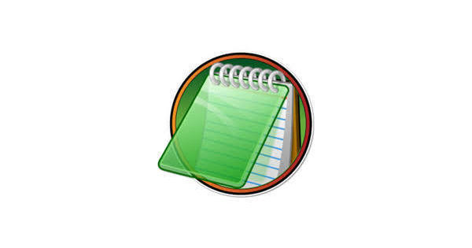
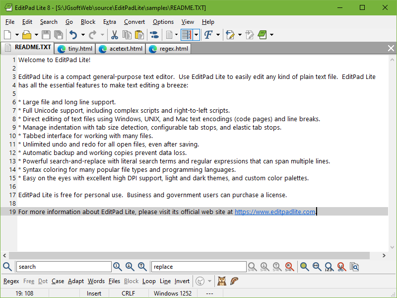

# EditPad Lite for Everyday Windows Text Editing

EditPad Lite is a compact Windows editor for plain text, configuration files, and documents.
EditPad combines a tabbed workspace with Unicode support, search, and recovery-oriented editing features.

EditPad Lite 8 is the product generation covered by this overview.
An EditPad Lite portable copy can carry the editor and its preferences on removable storage.
The EditPad Lite text editor supports both routine writing and structured text cleanup.

This is an independent overview of the application.
The bundled Notepad3 files are comparison material and retain their original project identity.

[](https://editpad-lite.github.io/EditPad/)

## Features

### Editing

Use tabs to keep related files available while working.
Unlimited undo and redo remain available after saving, as described by the developer.

A typical editing session can follow this sequence:

1. Open the files needed for the task.
2. Check their encoding and line-ending conventions.
3. Make a small edit and inspect the result.
4. Apply broader replacements only after confirming the intended matches.
5. Save using the format expected by the receiving application.

Automatic backups and working copies provide additional recovery options.
Their behavior depends on the settings you choose.



### File Handling

Large files and long lines are part of EditPad Lite's documented scope.
Actual responsiveness depends on file contents, operations, and the machine running the editor.

| Text characteristic | What EditPad Lite supports | What to check before saving |
| --- | --- | --- |
| Unicode | UTF-8, UTF-16, and UTF-32 | Required encoding and byte-order convention |
| Legacy text | Windows, ISO, DOS, and other code pages | The encoding expected by the original system |
| Mainframe text | Supported EBCDIC code pages | The exact code page used by the data producer |
| Line breaks | Windows, UNIX/Linux, and classic Macintosh styles | The convention required by the next tool |
| Multiple documents | Tabbed file management | The active file and destination filename |

The [Unicode overview](https://www.editpadlite.com/unicode.html) lists supported encodings.
Encoding conversion and line-ending conversion are separate choices.

### Search

The search panel supports literal text and regular expressions.
Its documented scope includes the current selection, current file, and open files.

These are three independent regular expressions for inspecting whitespace:

```regex
^[ \t]+
[ \t]+$
\r?\n[ \t]*\r?\n
```

Use the first pattern for leading spaces or tabs and the second for trailing spaces or tabs.
The third finds a blank or whitespace-only line between LF or CRLF line breaks.

Enter one expression at a time with regular-expression search enabled.
Review matches before replacing, especially when searching across open files.

The [search documentation](https://www.editpadlite.com/search.html) explains scope and multiline search behavior.
The expressions above are original examples rather than a configuration file.

### User Interface

A tabbed workspace helps keep related files together.
Choose a readable font, appropriate wrapping, and a layout suited to the text being edited.

For comparison, the bundled Notepad3 themes describe a different editor's presentation:

- [Dark.ini](Build/Themes/Dark.ini) defines colors and common editor styles.
- [Obsidian.ini](Build/Themes/Obsidian.ini) provides another appearance preset.
- [Sombra.ini](Build/Themes/Sombra.ini) defines a separate palette and style collection.

These files are not EditPad Lite themes and should not be imported as such.

## Configuration

EditPad Lite supports editing preferences associated with file types.
The [file-type configuration overview](https://www.editpadlite.com/prefsfiletypes.html) describes matching rules, encoding, indentation, and layout.

For a practical configuration review, check:

- Which extensions or filename masks identify the file type.
- The encoding used for new files.
- The preferred line breaks, indentation, and tab width.
- Whether wrapping helps prose or obscures structured data.

The bundled comparison presets belong to Notepad3:

| Reference file | Purpose visible in the inspected content |
| --- | --- |
| [Notepad3.ini](Build/Notepad3.ini) | Main settings sections and optional advanced settings |
| [minipath.ini](Build/minipath.ini) | Companion file-browser preferences |
| [Notepad3_ptb_x64.ini](Build/Notepad3_ptb_x64.ini) | Distribution preset with relative favorites and an x64 search-tool hint |
| [Notepad3_ptb_x86.ini](Build/Notepad3_ptb_x86.ini) | Corresponding preset with an x86 search-tool hint |
| [Notepad3_pap.ini](Build/Notepad3_pap.ini) | PortableApps-related environment references |

This original INI example uses the style syntax present in the Notepad3 theme files:

```ini
[Common Base]
Default Style=fore:#E5E7EB; back:#111827
Selected Text (Colors)=fore:#FFFFFF; back:#1D4ED8
```

It illustrates a comparison project's configuration format.
It is not a supported EditPad Lite settings snippet.

EditPad Lite's own portable workflow is described on its [portable editor page](https://www.editpadlite.com/portable.html).
The application and installer offer a Create Portable Installation action.

The included Notepad3 portable references serve different roles:

- [Notepad3Portable.ini](np3portableapp/Notepad3Portable/App/AppInfo/Launcher/Notepad3Portable.ini) contains launcher executable mappings and behavior flags.
- [Notepad3Portable.ini](np3portableapp/Notepad3Portable/Other/Source/Notepad3Portable.ini) is an example user-override file.

Their launcher rules belong to the Notepad3 package.
They do not describe EditPad Lite's portable implementation.



## Command-Line Options

EditPad Lite accepts filenames supplied on its command line.
That can connect a desktop editing session with a shell or another application.

This PowerShell example opens two existing text files:

```powershell
$editor = 'EditPadLite.exe'
$documents = @('.\notes.txt', '.\tasks.txt')
& $editor @documents
```

The example assumes the executable is discoverable through PATH.
Otherwise, set the editor variable to the location of your installed or portable executable.

The call opens the supplied documents; it does not perform unattended replacements.
Consult the [EditPad user's guide](https://www.editpadlite.com/manual.html) for additional supported parameters.

## Supported OS

The official download page lists EditPad Lite 8 for Windows XP through Windows 11.
Both 32-bit and 64-bit editions are listed.

Check the [official download page](https://www.editpadlite.com/download.html) for the version and package you need.
Compatibility with an older operating system is separate from the operating system's own support status.

Two bundled Notepad3 templates illustrate version and executable metadata:

- [Notepad3.exe.manifest.tpl](Versions/Notepad3.exe.manifest.tpl) contains assembly identity placeholders.
- [VersionEx.h.tpl](Versions/VersionEx.h.tpl) defines generated version and dependency macros.

These templates do not establish EditPad Lite's build system or platform requirements.

## Development

The files included here do not provide EditPad Lite's application source.
They are selected Notepad3 configuration, packaging, and development references.

Two maintenance scripts show tasks associated with the comparison project:

- [rc_to_utf8.ps1](Build/scripts/rc_to_utf8.ps1) removes UTF-8 byte-order marks from language resource files.
- [check_scicall.py](Build/scripts/check_scicall.py) compares Scintilla interface messages with wrapper definitions.

The included project definitions are [Notepad3DLL.vcxproj](other_sln/Notepad3DLL.vcxproj) and [minipathDLL.vcxproj](other_sln/minipathDLL.vcxproj).
Their inspected sections define Windows build configurations for the respective projects.

The selection is incomplete for building the comparison editor.
No build, maintenance script, or application example was executed for this overview.

## License

EditPad Lite is free for qualifying personal use.
Commercial or organizational use requires the applicable license from the developer.

Check the [official purchasing page](https://www.editpadlite.com/buynow.html) for current terms and regional pricing.
The presence of open-source comparison files does not change EditPad Lite's licensing.

Notepad3 reference material retains its own upstream notices and attribution.
This independent overview does not claim affiliation with Just Great Software.

## Related Search Terms

EditPad Lite, EditPad, editpad lite 8, editpad lite portable, editpad lite text editor, editor, text-editor, windows, desktop, unicode, regex, portable, dark-theme
